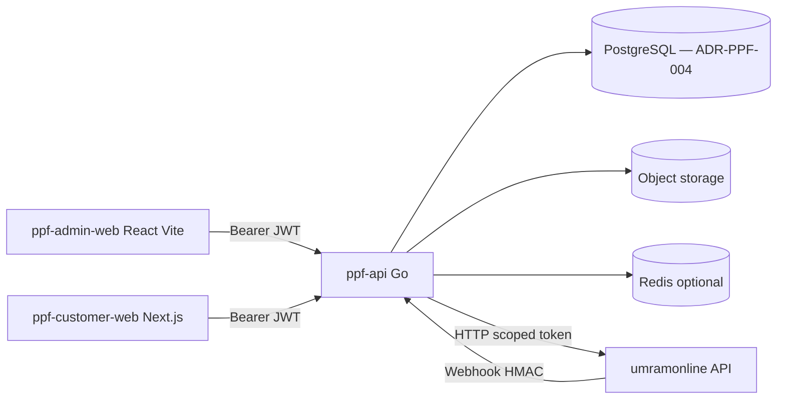

# PPF — Mimari

Backend (`ppf-api`) katmanları ve API yüzeyleri. Ürün kararları için [00-product-plan.md](./00-product-plan.md).

---

## Yüksek seviye



---

## Katmanlı yapı (modül başına)

Her bounded context aynı düzeni izler:

```text
internal/<module>/
  domain/              # Entities, value objects, domain errors
  application/         # Use cases, ports (repository interfaces)
  infrastructure/
    http/              # Handlers, route registration
    persistence/       # SQL/GORM implementations
    integration/       # umramonline client, webhooks
```

**Bağımlılık yönü:** `infrastructure` → `application` → `domain`. Interface’ler `application` katmanında.

**Composition root:** `cmd/api/main.go` — manual DI (framework yok).

---

## HTTP yüzeyleri

| Prefix | Tüketici | Middleware |
|--------|----------|------------|
| `/v1/admin/*` | ppf-admin-web | JWT + staff scopes + RBAC |
| `/v1/customer/*` | ppf-customer-web (ileride) | JWT + customer scopes + ownership |
| `/v1/webhooks/*` | umram / dış sistemler | HMAC / M2M, idempotency |
| `/health`, `/ready` | Load balancer | Public — NFR-009; `/ready` PostgreSQL ping (503 yoksa) |

Admin ve customer route’ları **aynı generic handler** ile birleştirilmez; middleware claim seti farklıdır.

---

## Veri sahipliği

| Veri | Sahip |
|------|--------|
| PPF iş emri, randevu, uygulama fotoğrafı, PPF SKU hareketi | PPF PostgreSQL (NFR-008, ADR-PPF-004) |
| Müşteri/araç master, expertise, merkezi ödeme | umramonline |
| PPF’de umram referansı | `umram_customer_id`, `umram_vehicle_id` vb. (English columns) |

---

## Entegrasyon kalıpları

1. **Senkron:** Umram HTTP API + ACL mapping (DTO → domain).
2. **Asenkron (ileride):** Transactional outbox → queue → webhook consumer.
3. **Yasak:** Umram DB connection string, batch sync CLI doğrudan MySQL.

---

## Gözlemlenebilirlik

- Her istek: **X-Request-Id** (ve mümkünse W3C **traceparent**).
- Structured JSON log; PII maskeleme.
- Sentry (veya eşdeğeri) + metrikler (latency, error rate).

---

## Frontend mimarisi (admin)

- SPA; routing client-side.
- Server state: TanStack Query; OpenAPI-generated types.
- Auth token refresh: IdP SDK veya `oauth4webapi` pattern; token localStorage yerine **memory + refresh** tercih edilir (XSS riski ADR’de netleştirilir).

Customer (Next) eklendiğinde aynı API client paketi / codegen paylaşılabilir; OAuth client ayrı kalır.

## HTTP yanıt özeti

- **2xx:** `{ "data": ... }` — [02-api-responses.md](./02-api-responses.md)
- **4xx/5xx:** RFC **9457** `application/problem+json` (legacy `success: false` yok)
