# PPF — İş emri yaşam döngüsü

> Durum: Onaylı taslak · Tarih: 2026-10-15  
> İlgili: [03-requirements.md](./03-requirements.md) (FR-201–206, FR-301–305)

---

## 1. Durumlar

| Durum kodu | UI (TR) | Açıklama |
|------------|---------|----------|
| `draft` | Taslak | Sihirbaz tamamlanmamış veya kaydedilmiş taslak |
| `payment_pending` | Ödeme bekliyor | Tahsilat bekleniyor |
| `at_supplier` | Tedarikçide | Uygulama tedarikçi firmada |
| `in_application` | Uygulamada | Uygulama bayi veya saha da |
| `delivered` | Teslim edildi | Müşteriye teslim; garanti/sertifika tetiklenir |
| `invoiced` | Faturalandı | Fatura kuyruğu tamamlandı |
| `cancelled` | İptal | Sonlandırılmış |

---

## 2. İzin verilen geçişler (özet)

```mermaid
stateDiagram-v2
  [*] --> draft
  draft --> payment_pending: onay / tahsilat adımı
  draft --> cancelled
  payment_pending --> at_supplier: ödeme OK + tedarikçi kalemi
  payment_pending --> in_application: ödeme OK + bayi uygulaması
  payment_pending --> cancelled
  at_supplier --> in_application: tedarikçi tamamladı / bayi devraldı
  in_application --> delivered: teslim
  at_supplier --> delivered: doğrudan teslim (politika)
  delivered --> invoiced: fatura kesildi
  delivered --> cancelled: iptal (nadir; ADR)
  invoiced --> [*]
  cancelled --> [*]
```

Geçersiz geçiş: HTTP **422** + RFC 9457 (`type` validation / domain error).

---

## 3. Detay sayfası bölümleri

| Bölüm | İçerik |
|--------|--------|
| Araç ve müşteri | Plaka, şase, marka/model, yıl, renk, segment, ekspertiz referansı; müşteri umram id + iletişim |
| Kalemler | Ürün, adet, uygulayıcı (bayi/tedarikçi), fiyat listesi dönemi, bölge/segment fiyat bağlamı, satır tutarları |
| Form cevapları ve fiziki durum | Kategori bazlı soru setleri; foto/belge (`media`) |
| Tahsilat | Paynet referansları, satır eşlemesi, durum |
| Süreç | Durum geçmişi, tedarikçi aksiyonları (ör. uygulamaya başla) |
| Garanti ve sertifika | Teslim sonrası kayıtlar, QR sertifika |
| İşleme dokunanlar ve prim | Katılımcılar; prim teslimde yazılır |
| Bildirimler | SMS/e-posta kayıtları |

---

## 4. Satış sihirbazı adımları

| Adım | Açıklama | Umran (anlık) |
|------|----------|----------------|
| 1 | Ekspertiz / araç bilgisi | Rapor kodu ile getir (bayi kapsamı) |
| 2 | Plaka/şase doğrulama | Validation API |
| 3 | Müşteri | Müşteri no ile lookup |
| 4 | Ürün ve kalem | Yerel katalog + fiyat motoru |
| 5 | Soru setleri | Uygulamalı ürün formları |
| 6 | Tahsilat özeti | Paynet (Phase-3) veya sonraki adıma bırak |
| 7 | Özet ve oluştur | `draft` veya `payment_pending` |

Adım sayısı UI’da birleştirilebilir; mantıksal sıra korunur.

---

## 5. Olaylar (domain events — ileride)

| Olay | Tetik |
|------|--------|
| `work_order.delivered` | Prim hesaplama, garanti kaydı, fatura kuyruğu, bildirim |
| `work_order.payment_captured` | Durum ilerlemesi |
| `stock.below_minimum` | Otomatik stok siparişi (FR-504) |

Faz 5 outbox/event ADR’si ile async tüketim.

---

## 6. API notları

- Durum geçişi: `PATCH /v1/admin/work-orders/{id}/status` (OpenAPI’de netleştirilecek).
- Idempotency-Key zorunlu: ödeme onayı, teslim, iptal.
- Liste filtreleri: `status`, `branch_id`, tarih aralığı.

---

**Son güncelleme:** 2026-10-15
